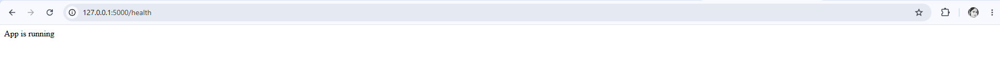
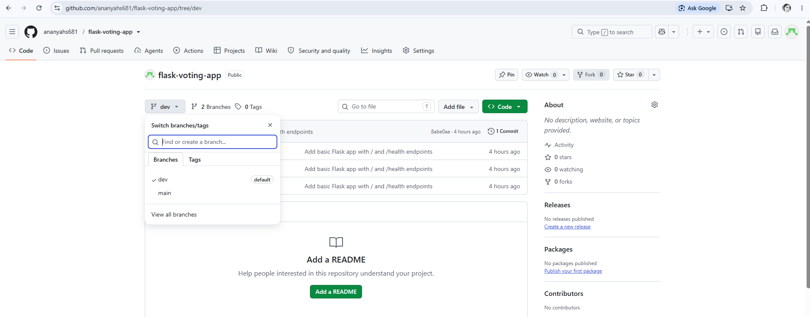
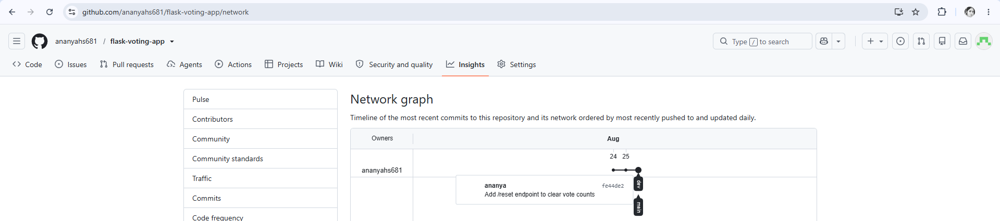

# Flask Voting App

## Project Description

This is a simple web-based voting application built with Python and Flask. It lets you cast a vote for any candidate by visiting a URL, and view the live vote counts for everyone who has been voted for so far. Votes are stored in memory while the server is running, and there's an endpoint to reset all counts back to zero.

## Installation and Setup

Follow these steps in order to run the project on your own machine:

```bash
# 1. Clone the repository
git clone https://github.com/ananyahs681/flask-voting-app.git
cd flask-voting-app

# 2. Create and activate a virtual environment
python3 -m venv venv
source venv/bin/activate        # On Windows: venv\Scripts\activate

# 3. Install dependencies
pip install flask

# 4. Run the app
python app.py
```

The server will start at `http://127.0.0.1:5000`.

## API Endpoint Reference

| Endpoint | Method | Description | Example Response |
|---|---|---|---|
| `/` | GET | Welcome message | `Welcome to the App` |
| `/health` | GET | Confirms the server is running | `App is running` |
| `/vote/<name>` | GET | Records one vote for `<name>`. First-time names start at 1, existing names increment. | `Vote recorded for alice. Total votes: 3` |
| `/results` | GET | Returns current vote counts for all candidates as JSON | `{"alice": 3, "bob": 1}` |
| `/reset` | GET | Clears all vote counts | `{"msg": "All votes have been reset"}` |

## Git Workflow

This project follows a `dev` → `main` branching workflow:

- All development happens on the `dev` branch first
- Once a feature is complete and tested locally, `dev` is merged into `main`
- `main` only ever contains stable, working code — nothing is committed to it directly

```
dev:   [Task 1: / and /health] ──▶ merged into main ──▶ Version 1
dev:   [/vote, /results] ──▶ [/reset] ──▶ merged into main ──▶ Version 2
```

Each version was released by pushing `dev`, then checking out `main`, merging `dev` into it, and pushing `main` — so the commit history on `main` clearly shows Version 2 built directly on top of Version 1, not rewritten from scratch.

## Version History

| Version | What was included |
|---|---|
| **Version 1** | Basic Flask app with `/` and `/health` endpoints |
| **Version 2** | Added the voting feature (`/vote/<name>`, `/results`) and a `/reset` endpoint to clear vote counts |

## Screenshots

**Application running in the browser:**



**GitHub repository showing `dev` and `main` branches:**



**Commit/merge history showing Version 1 and Version 2 releases:**



## Docker Setup

The Flask Voting App can be containerized and run using Docker.

### Prerequisites

- Docker Desktop installed and running
- Git
- Python (for local development)

### Build the Docker Image

From the project root:

```bash
docker build -t flask-voting-app:1.0 .
```

### Run the Docker Container

Run the container and map port `5000` on the host to port `5000` inside the container:

```bash
docker run -d --name flask-voting-app -p 5000:5000 flask-voting-app:1.0
```

### Verify the Container

Check that the container is running:

```bash
docker ps
```

Expected port mapping:

```text
0.0.0.0:5000->5000/tcp
```

The application can then be accessed at:

```text
http://localhost:5000
```

### Test the Application

Health check:

```text
http://localhost:5000/health
```

Vote for a candidate:

```text
http://localhost:5000/vote/alice
```

View results:

```text
http://localhost:5000/results
```

Reset all votes:

```text
http://localhost:5000/reset
```

### View Container Logs

To view the application logs:

```bash
docker logs flask-voting-app
```

To follow logs continuously:

```bash
docker logs -f flask-voting-app
```

### Stop and Start the Container

Stop the running container:

```bash
docker stop flask-voting-app
```

Start it again:

```bash
docker start flask-voting-app
```

### Docker Architecture

```text
Host Machine
     |
     | Port 5000
     v
Docker Container
     |
     | Port 5000
     v
Flask Application
     |
     +-- /
     +-- /health
     +-- /vote/<name>
     +-- /results
     +-- /reset
```

### Current Application Limitation

Votes are currently stored in application memory. This means the vote data is lost when the application restarts, and multiple application instances would maintain separate vote states.

For a production deployment with multiple instances or containers, the vote state should be stored in an external persistent data store such as a database or managed storage service.

## DevOps Deployment Progress

The project is being progressively extended from a simple Flask application into a cloud/DevOps deployment project.

Current progress:

- Flask application created and tested locally
- Git branching and versioning implemented
- Docker containerization completed
- Docker image successfully built and tested
- Application logs verified using Docker
- Dedicated `devops-aws-deployment` branch created

Upcoming work includes:

- Terraform infrastructure as code
- AWS infrastructure deployment
- Container registry integration
- Kubernetes/EKS deployment
- CI/CD pipeline
- Monitoring and production-oriented configuration


## Terraform Infrastructure — Hands-on Practice

### Objective

Use Terraform to provision and manage AWS infrastructure as code for the Flask Voting App project.

### Environment

- AWS CLI: 2.35.21
- Terraform: 1.15.8
- AWS region: `ap-southeast-2` (Sydney)
- AWS CLI profile: `flask-voting-app`
- Terraform provider: AWS

### Terraform workflow practised

1. `terraform init` — initialized the working directory and installed the AWS provider.
2. `terraform fmt` — formatted Terraform configuration files.
3. `terraform validate` — validated the configuration.
4. `terraform plan` — previewed proposed infrastructure changes.
5. `terraform apply` — created the configured AWS resources.
6. `terraform state list` — listed resources tracked in Terraform state.
7. `terraform output` — displayed the bucket name output.

### Infrastructure provisioned

Terraform successfully created four AWS resources:

- S3 bucket for the project.
- S3 public access block.
- Default server-side encryption using AES256 (SSE-S3).
- S3 bucket versioning.

The bucket is configured to block public access, encrypt new objects by default, and retain previous object versions when objects are overwritten or deleted.

### Terraform concepts learned

- **Provider:** Connects Terraform to AWS.
- **Resource:** Declares infrastructure to create or manage.
- **Output:** Exposes useful values from managed infrastructure.
- **State:** Maps Terraform configuration to the infrastructure Terraform manages.
- **Plan:** Previews proposed changes before execution.
- **Apply:** Executes approved infrastructure changes.
- **Drift:** A difference between the actual infrastructure and the configuration/state Terraform expects.

### Current limitations and next steps

- Add input variables to make configuration reusable.
- Review state security and remote backend options.
- Practise drift detection, modules and resource cleanup.
- Continue building the AWS architecture required for the project, including IAM, networking, compute, container registry, monitoring and deployment components.
- Learn Kubernetes and EKS deployment and troubleshooting.

**Project status:** The S3 resources above have been provisioned successfully. Other infrastructure and deployment components remain future work until implemented and verified.
